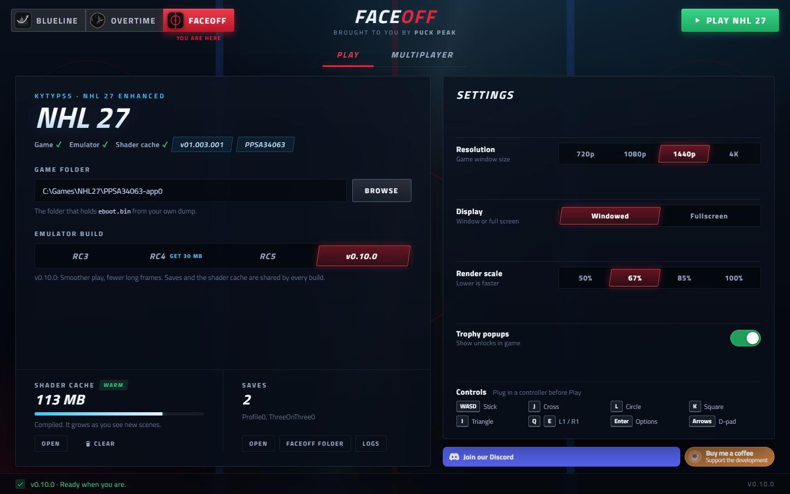
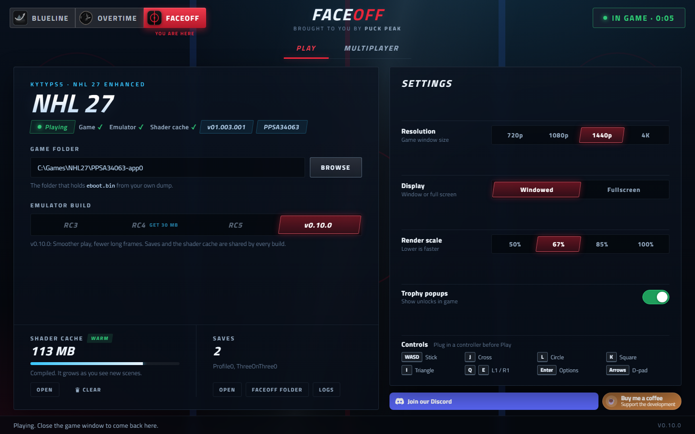
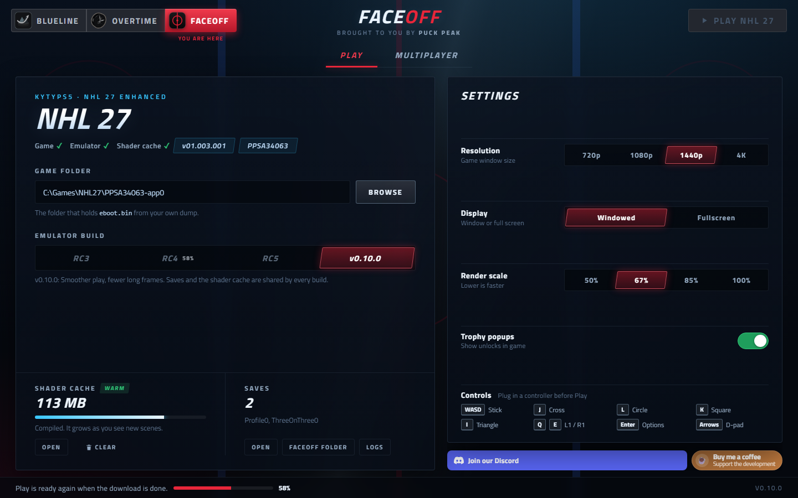
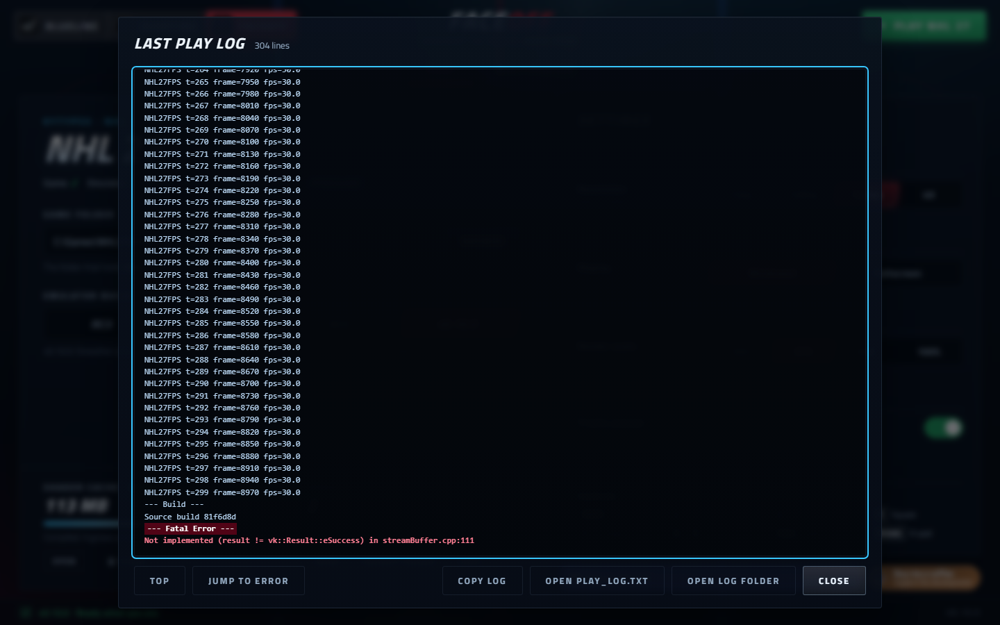
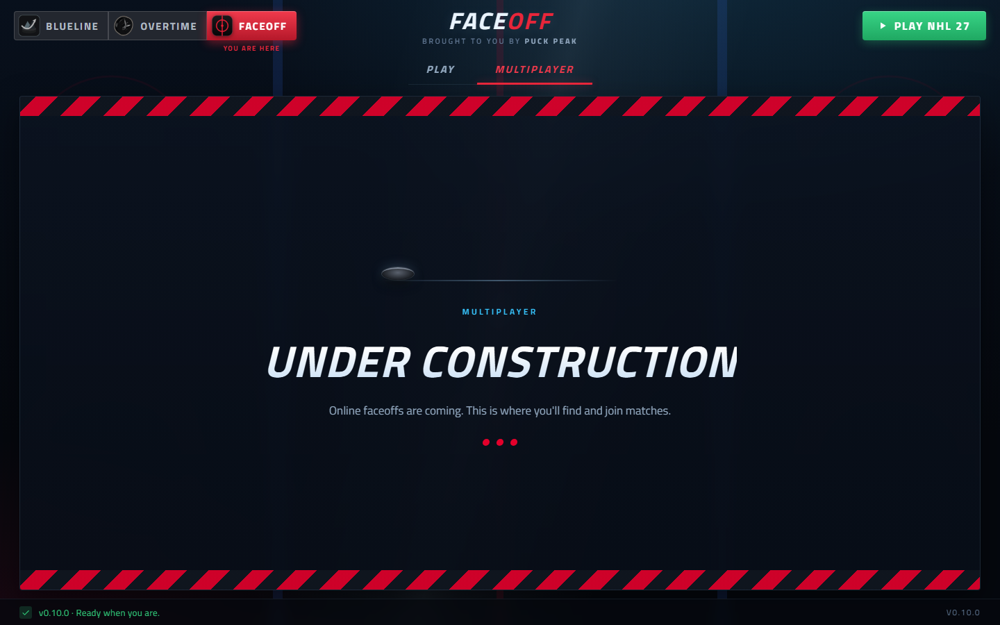

# 🏒 FACEOFF: NHL 27 on PC

### Play **NHL 27** on your Windows PC: menus at 30 fps, play at 60.
*One launcher picks the emulator build, sets it up and starts the game. Brought to you by [Puck Peak](https://www.puckpeak.com).*

[**⬇ Download the latest version**](../../releases/latest)
&nbsp;·&nbsp; [Quick start](QUICKSTART.md) &nbsp;·&nbsp; [What's new](CHANGELOG.md)

Questions, news and help: **[gg.puckpeak.com](https://gg.puckpeak.com)**

## ✨ What you get

- 🖥 **A launcher, not a pile of scripts.** Unzip, start `Faceoff.exe`, point it at your NHL 27 folder and press
  **Play NHL 27**. Faceoff checks the game, the emulator and the shader cache and shows a check mark for each.
- ⚡ **A tuned emulator.** NHL 27 runs on our build of [duy64/KytyPS5-nhl](https://github.com/duy64/KytyPS5-nhl), a
  KytyPS5 fork: the game's own frame pacing (30 fps menus, 60 fps play), PGO and AVX2 builds, and fixes for Be a Pro
  crashes and broken images. v0.10.0 adds smoother play: batched memory faults and locks that stop burning the CPU.
- 🔀 **Pick your build.** v0.10.0, RC5, RC4 or RC3 on the Play tab. A build you don't have downloads when you pick it
  and is checked against its SHA-256.
- 🎛 **Settings in one place.** Resolution (720p to 4K), windowed or fullscreen, render scale and trophy pop-ups.
- 🔄 **Updates itself.** Faceoff checks for a new release when it starts and installs it in one click.
- 🔒 **Your saves stay put.** Saves, trophies and the shader cache live next to `Faceoff.exe`, shared by every build.
  Updates never touch them.
- 🧾 **Crash reports one click away.** After a crash Faceoff shows the play log, jumps to the error and copies it for
  a bug report.
- 🏒 **The Puck Peak family.** Same look as Blueline and Overtime, with the app dock to jump between them.

 
 

## 🚀 Get started

1. Download `Faceoff-v0.10.0.zip` from the [release page](../../releases/latest) and extract it anywhere you can write
   to (not inside `Program Files`, at least 2 GB free).
2. Start `Faceoff.exe`. Windows SmartScreen warns because the exe is not signed: choose **More info**, then
   **Run anyway**.
3. **Browse** to your NHL 27 folder, the one that holds `eboot.bin`.
4. Press the green **Play NHL 27** button. The first arena load stutters for 30 s or longer while shaders compile;
   that happens once.

**Coming from RC5:** Faceoff offers the update by itself and keeps your saves and shader cache. Take the new
`Faceoff.exe` from the release once by hand: RC5's launcher reads 0.10.0 as older.

Step by step, with controls and troubleshooting: [QUICKSTART.md](QUICKSTART.md).

## What you need

- Windows 10 or 11, 64-bit.
- A CPU with AVX2 (Intel Haswell / AMD Zen or newer). Without AVX2 the game won't start.
- About 14 GB of free RAM and 10 GB of video memory at 1440p.
- The latest Microsoft Visual C++ Redistributable (x64) and a current GPU driver.
- Your own dump of NHL 27: **PPSA34063, tested with 01.003.001**.

Tested on a Ryzen 7 9800X3D, an RTX 5080 and 32 GB of RAM. Other GPUs have not been tried here.

## Known issues

- **Sudden fps drops.** Some matches drop to 5-10 fps for a few seconds up to more than a minute. Not fixed yet.
- **Stutter** when a cutscene cuts to the next one, and when play starts.
- **Shadows** can look blocky in places.
- **Rare crashes:** inside the NVIDIA driver while compiling a shader on a fresh cache, while creating a Be a Pro
  player, and a silent exit right after the window opens.
- **Starting again right after closing** can fail with `could not reserve 13824 MB for guest direct memory`. Wait a
  few seconds and try again.
- If your profile shows "Sign in required", press OK. Offline modes work; online modes don't (yet).
- The upstream known bugs (jersey cloth, some skin tones, facial hair, bright pixels, logos) are unchanged.

Hit a crash? Keep `play_log.txt` (Faceoff's **Logs** button opens its folder), note your GPU and driver, and tell us
on [Discord](https://gg.puckpeak.com).

## How it works

| Part | What it does |
|---|---|
| `Faceoff.exe` | The launcher (pywebview): game folder, build picker, settings, auto-update, crash log |
| `builds/<build>/` | One emulator build each: `kyty_emulator.exe`, its `cfgGlobal.json` and assets |
| `_SaveData`, `_Trophies`, `_PipelineCache` | Saves, trophies and the shader cache, next to `Faceoff.exe`, shared by every build |
| `src/` (this repository) | The emulator source: KytyPS5 with the NHL 27 changes |
| `tools/nhl27/` | The start script and settings shipped in the zip |

The emulator runs with the Faceoff folder as its working folder, so whichever build you pick, it uses the same saves
and cache. `Play-NHL27.cmd` is a plain fallback that starts the build Faceoff last picked. Don't start
`kyty_emulator.exe` directly: it would run without the NHL 27 settings.

## What this project does not ship

No game files, eboot, firmware, keys or extracted EA assets are in this repository or in the release. You need your
own legally obtained copy of NHL 27.

## Credits

duy64 (KytyPS5-nhl and its NHL 27 fixes), nmzik, TheCruZ, Artyom Zabroda, superkeka, pengui07, pargi and the
[KytyPS5](https://github.com/KytyPS5/KytyPS5) authors, on top of the original [Kyty](https://github.com/InoriRus/Kyty).
AnyPS5 (boykopovar) was used as a reference only; no code was copied from it.

The changes, measurements and notes were made with an AI coding assistant (Claude) driving the builds, test runs and
log analysis; play testing is by hand. Each release's details are in [CHANGELOG.md](CHANGELOG.md).

## Disclaimer

Faceoff is an unofficial fan project by [Puck Peak](https://www.puckpeak.com). It is not affiliated with, endorsed by
or sponsored by Electronic Arts, EA SPORTS, Sony Interactive Entertainment, the NHL or the NHLPA. All trademarks
belong to their owners. No money is made from this project.

## License

The emulator is [GPL-2.0](LICENSE); bundled libraries' licences are in `licenses/` in the release zip. The source of
each release is attached to it as `*-src.zip` and tagged in this repository.
